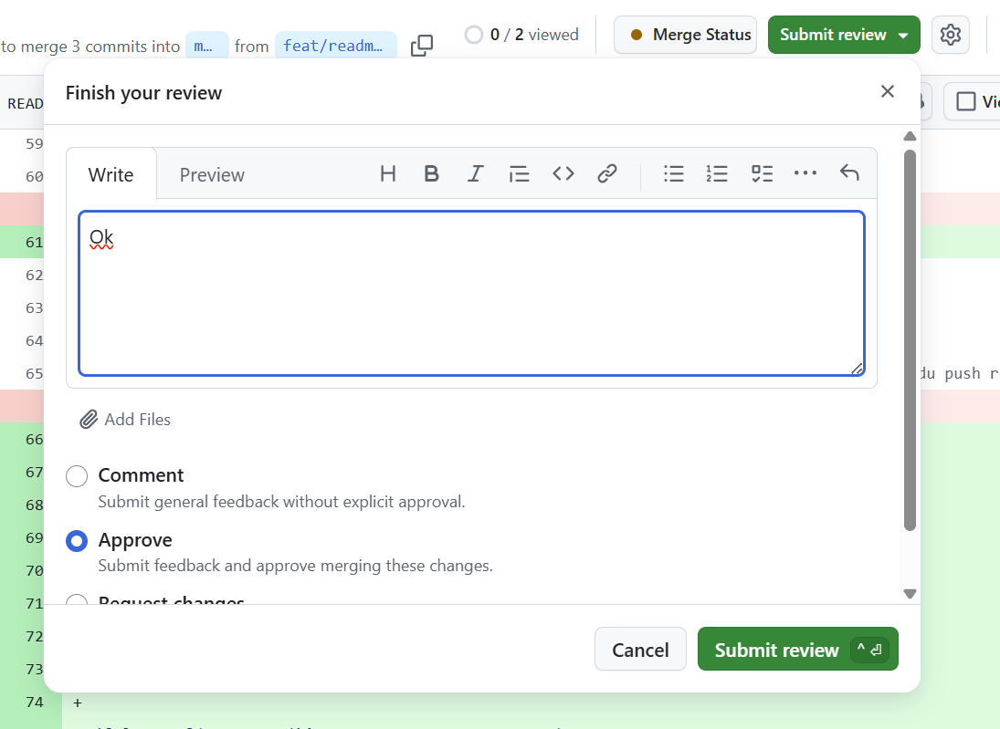

# TaskFlow — dépôt fil rouge CI/CD

TaskFlow est une petite API de gestion de tâches écrite en Python avec FastAPI.
C'est le projet fil rouge du module CI/CD (Mastère DevOps M1, Sup de Vinci) :
pendant trois jours, vous allez construire autour d'elle un pipeline complet
qui teste, construit, sécurise et livre l'application.

## Lancer l'API en local

Prérequis : Python 3.10 ou plus récent.

```bash
python3 -m venv .venv
source .venv/bin/activate          # Windows : .venv\Scripts\activate
pip install -r requirements-dev.txt
uvicorn app.main:app --reload
```

L'API répond sur http://localhost:8000 et sa documentation interactive est sur
http://localhost:8000/docs.

## Vérifier le code

```bash
pytest           # tests automatiques
ruff check .     # lint
ruff format .    # mise en forme
```

## Lancer avec Docker

```bash
docker build -t taskflow .
docker run --rm -p 8000:8000 taskflow
```

## Endpoints

| Méthode | Chemin | Rôle |
| --- | --- | --- |
| GET | `/health` | État de l'API et version |
| GET | `/tasks` | Liste des tâches |
| GET | `/tasks/search?q=...` | Recherche dans les titres |
| POST | `/tasks` | Crée une tâche (`{"title": "..."}`) |
| GET | `/tasks/{id}` | Détail d'une tâche |
| PATCH | `/tasks/{id}/done` | Marque une tâche comme faite |
| DELETE | `/tasks/{id}` | Supprime une tâche (en-tête `X-API-Token` requis) |

## Configuration

| Variable | Rôle | Défaut |
| --- | --- | --- |
| `APP_VERSION` | Version affichée par `/health` | `0.1.0` |
| `DB_PATH` | Fichier SQLite | `taskflow.db` |
| `API_TOKEN` | Jeton exigé pour supprimer une tâche | vide (suppression désactivée) |
| `NOTIFY_WEBHOOK_URL` | Webhook appelé à chaque création de tâche | vide (désactivé) |

## Équipe

<!-- Lab J1 : remplacez par les noms du binôme -->
- Joseph DELNORD
- Yani SADKI

## Gouvernance du dépôt

<!-- Lab J1 : listez les règles activées sur main, pourquoi chacune, et ajoutez la capture du push refusé -->

### Règles activées sur `main` et justifications :

- **Restrict deletions** : empêche la suppression accidentelle ou malveillante de la branche de production `main`.
- **Block force pushes** : préserve l'intégrité et la traçabilité de l'historique Git en interdisant toute réécriture (`git push --force`).
- **Require a pull request before merging (1 approval)** : garantit que tout changement est revu par au moins un pair (le binôme), réduisant ainsi les bugs et facilitant le partage de connaissances.
- **Require review from Code Owners** : exige obligatoirement l'approbation d'un des propriétaires déclarés dans `.github/CODEOWNERS` dès qu'un fichier critique (ici `.github/workflows/`) est modifié.


### Capture du push direct refusé :


Cela montre que les règles de gouvernance sont bien appliquées et que tout changement doit passer par une Pull Request.

### Processus de Pull Request

1. je créé une Pull Request, je remplis les informations nécessaires et je soumets pour revue.

  


2. Mon coéquipier révise la Pull Request et laisse ses commentaires ou approbations.

 

### Création des CODEOWNERS

1. Je créé les CODEOWNERS pour définir les propriétaires des fichiers critiques.


2. Je coche la case correspondant à l'option "Require review from Code Owners" pour activer l'approbation obligatoire des propriétaires de fichiers critiques.


3. Je créé la PR et mon coéquipier l'approuve en tant que propriétaire de fichiers critiques.

 


### Bonus : signature des commits

1. Pour renforcer la sécurité et la traçabilité, nous pouvons activer la signature des commits.
2. Chaque commit devra être signé avec la clé GPG configurée, assurant ainsi l'authenticité de l'auteur du commit.
3. Les commits non signés seront rejetés, garantissant que chaque modification est vérifiable et provient d'un contributeur authentique.


Cette capture montre l'activation de la signature des commits et la vérification de l'authenticité de chaque modification.

## Pipeline CI

Le workflow [ci.yml](.github/workflows/ci.yml) s'exécute lors d'une Pull Request vers `main` et lors d'un push sur `main`. Il lance deux jobs indépendants en parallèle :

- **lint** : exécute `ruff check .` pour détecter les erreurs de style, les imports inutilisés et les erreurs statiques définies par la configuration Ruff du projet.
- **test** : exécute `pytest` pour vérifier les comportements de l'API et éviter les régressions couvertes par les tests automatisés.

Les checks `lint` et `test` devront tous les deux réussir avant de pouvoir fusionner une Pull Request.


Ensuite on a définit un ruleset pour s'assurer que les jobs lint et test réussissent avant de fusionner une Pull Request dans `main`.


### Capture d'une Pull Request bloquée

À compléter à l'étape 5 avec la capture d'une Pull Request dont la fusion est bloquée par un job CI en échec.
