# TaskFlow — dépôt fil rouge CI/CD

TaskFlow est une petite API de gestion de tâches écrite en Python avec FastAPI.
C'est le projet fil rouge du module CI/CD (Mastère DevOps M1, Sup de Vinci) :
pendant trois jours, vous allez construire autour d'elle un pipeline complet
qui teste, construit, sécurise et livre l'application.

## Lancer l'API en local

Prérequis : Python 3.10 ou plus récent.

```bash
python3 -m venv .venv
source .venv/bin/activate          # Windows : .venv\Scripts\activate
pip install -r requirements-dev.txt
uvicorn app.main:app --reload
```

L'API répond sur http://localhost:8000 et sa documentation interactive est sur
http://localhost:8000/docs.

## Vérifier le code

```bash
pytest           # tests automatiques
ruff check .     # lint
ruff format .    # mise en forme
```

## Lancer avec Docker

```bash
docker build -t taskflow .
docker run --rm -p 8000:8000 taskflow
```

## Endpoints

| Méthode | Chemin | Rôle |
| --- | --- | --- |
| GET | `/health` | État de l'API et version |
| GET | `/tasks` | Liste des tâches |
| GET | `/tasks/search?q=...` | Recherche dans les titres |
| POST | `/tasks` | Crée une tâche (`{"title": "..."}`) |
| GET | `/tasks/{id}` | Détail d'une tâche |
| PATCH | `/tasks/{id}/done` | Marque une tâche comme faite |
| DELETE | `/tasks/{id}` | Supprime une tâche (en-tête `X-API-Token` requis) |

## Configuration

| Variable | Rôle | Défaut |
| --- | --- | --- |
| `APP_VERSION` | Version affichée par `/health` | `0.1.0` |
| `DB_PATH` | Fichier SQLite | `taskflow.db` |
| `API_TOKEN` | Jeton exigé pour supprimer une tâche | vide (suppression désactivée) |
| `NOTIFY_WEBHOOK_URL` | Webhook appelé à chaque création de tâche | vide (désactivé) |

## Équipe

<!-- Lab J1 : remplacez par les noms du binôme -->
- Joseph DELNORD
- Yani SADKI

## Gouvernance du dépôt

<!-- Lab J1 : listez les règles activées sur main, pourquoi chacune, et ajoutez la capture du push refusé -->

### Règles activées sur `main` et justifications :

- **Restrict deletions** : empêche la suppression accidentelle ou malveillante de la branche de production `main`.
- **Block force pushes** : préserve l'intégrité et la traçabilité de l'historique Git en interdisant toute réécriture (`git push --force`).
- **Require a pull request before merging (1 approval)** : garantit que tout changement est revu par au moins un pair (le binôme), réduisant ainsi les bugs et facilitant le partage de connaissances.
- **Require review from Code Owners** : exige obligatoirement l'approbation d'un des propriétaires déclarés dans `.github/CODEOWNERS` dès qu'un fichier critique (ici `.github/workflows/`) est modifié.

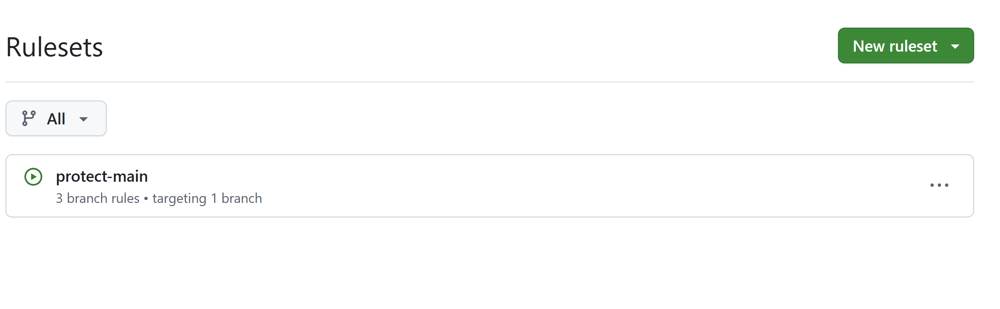

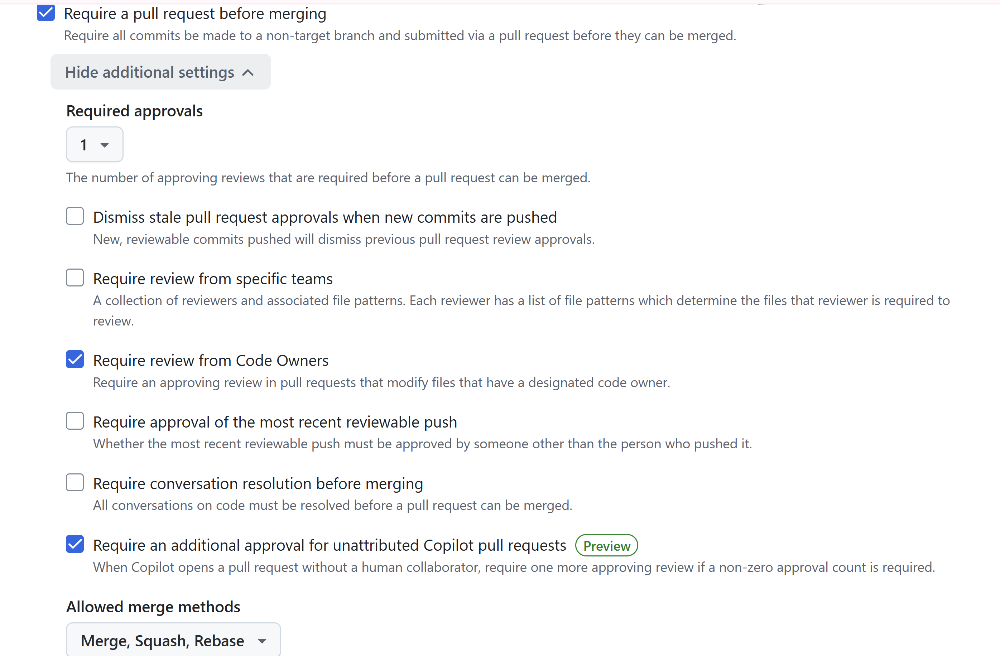

### Capture du push direct refusé :

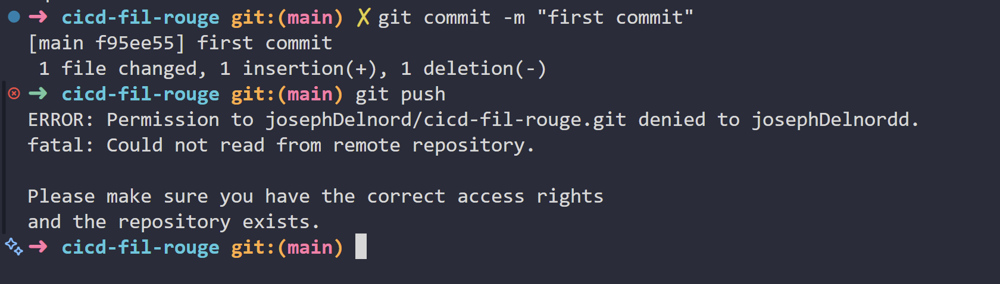

Cela montre que les règles de gouvernance sont bien appliquées et que tout changement doit passer par une Pull Request.

### Processus de Pull Request

1. je créé une Pull Request, je remplis les informations nécessaires et je soumets pour revue.

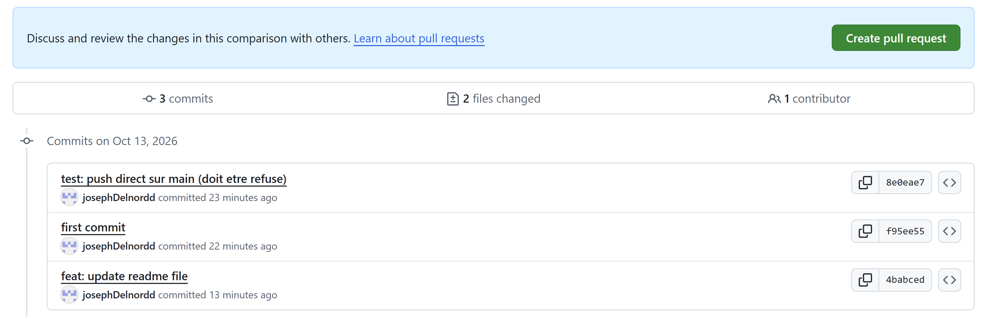

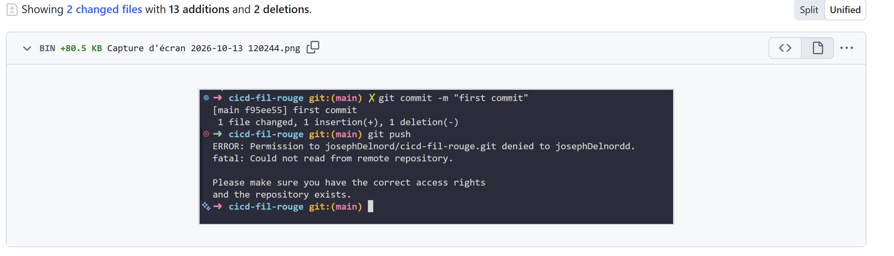

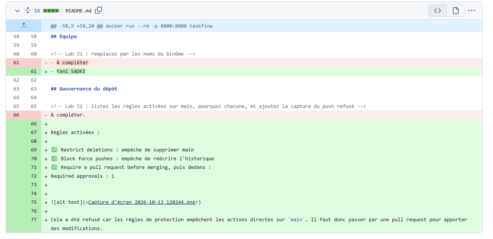

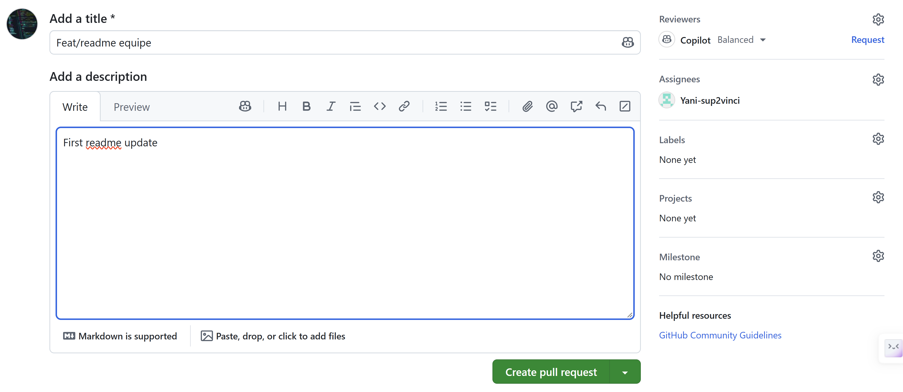

2. Mon coéquipier révise la Pull Request et laisse ses commentaires ou approbations.

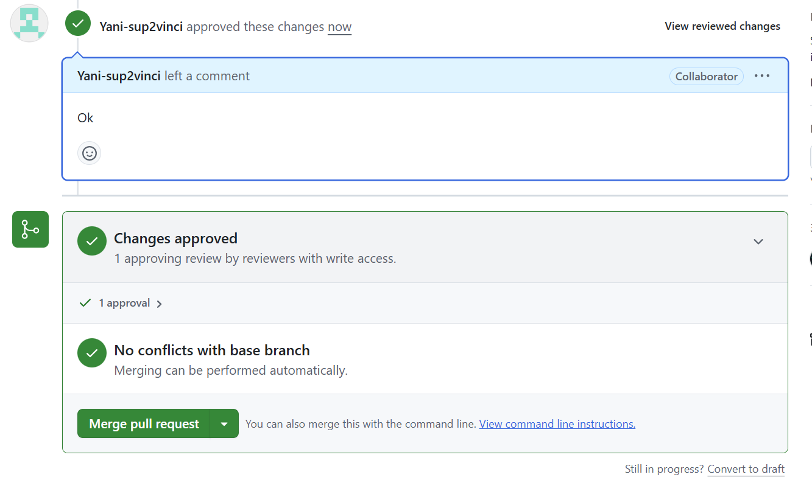


### Création des CODEOWNERS

1. Je créé les CODEOWNERS pour définir les propriétaires des fichiers critiques.

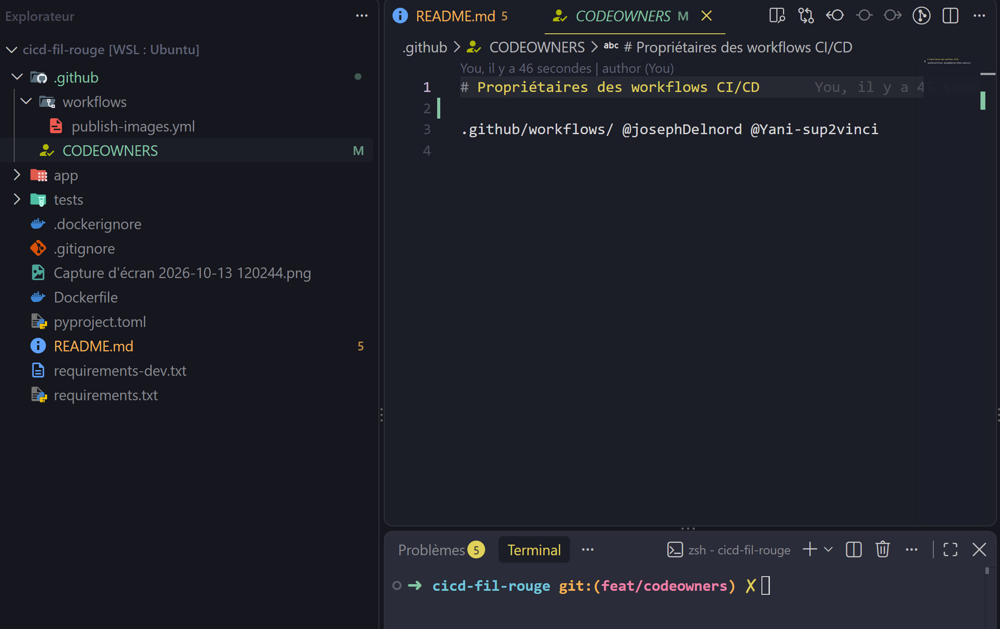

2. Je coche la case correspondant à l'option "Require review from Code Owners" pour activer l'approbation obligatoire des propriétaires de fichiers critiques.


3. Je créé la PR et mon coéquipier l'approuve en tant que propriétaire de fichiers critiques.

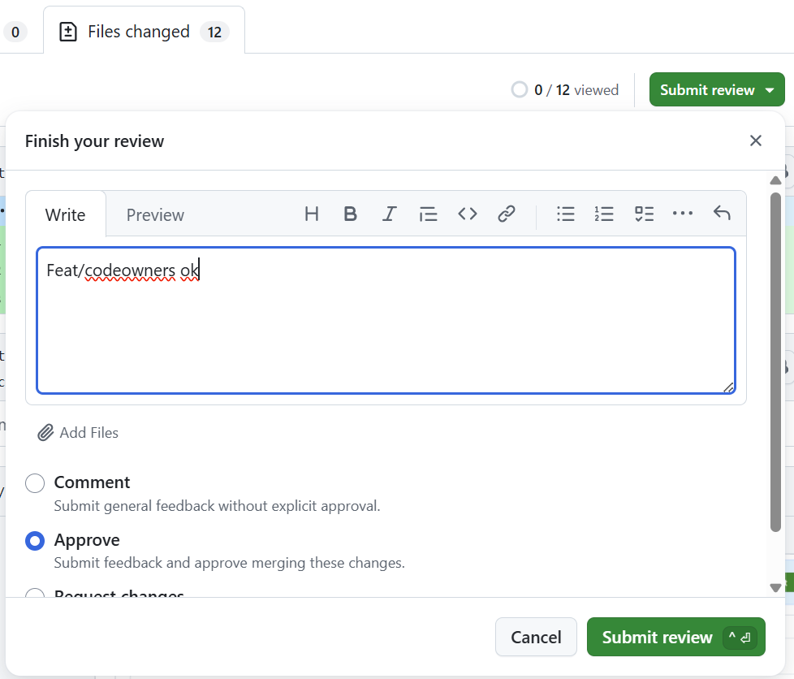

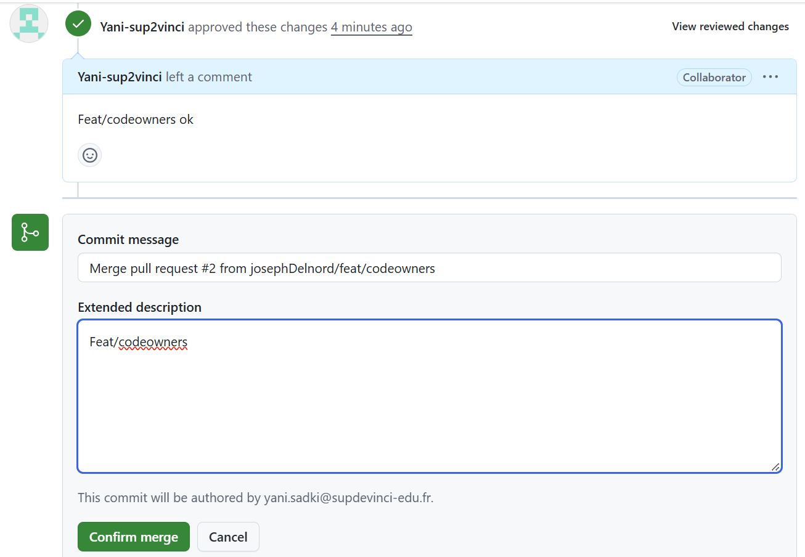

### Bonus : signature des commits

1. Pour renforcer la sécurité et la traçabilité, nous pouvons activer la signature des commits.
2. Chaque commit devra être signé avec la clé GPG configurée, assurant ainsi l'authenticité de l'auteur du commit.
3. Les commits non signés seront rejetés, garantissant que chaque modification est vérifiable et provient d'un contributeur authentique.

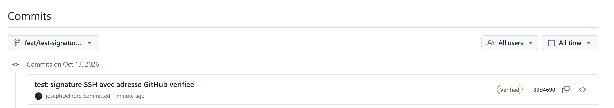

Cette capture montre l'activation de la signature des commits et la vérification de l'authenticité de chaque modification.

## Pipeline CI

Le workflow [ci.yml](.github/workflows/ci.yml) s'exécute sur les Pull Requests à destination de `main` et lors d'un push sur `main`. Il lance les vérifications en parallèle et interrompt les exécutions précédentes d'une même branche lorsqu'une nouvelle arrive.

- **lint** : lance `ruff check .` pour contrôler le style et détecter des erreurs statiques.
- **test** : exécute `pytest` sur Python 3.11, 3.12 et 3.13. Le cache pip évite de retélécharger les dépendances quand la clé de cache existe déjà. Chaque version publie un rapport JUnit en artefact, même si ses tests échouent.
- **CI OK** : attend la fin de `lint` et de toute la matrice `test`, puis échoue si l'un de ces résultats n'est pas réussi. C'est le check stable à exiger dans le ruleset.

Une matrice crée des checks distincts par version de Python, dont les noms peuvent changer selon la matrice. Si le ruleset exige encore les anciens checks `lint` et `test`, la PR peut donc rester bloquée malgré des résultats verts. Le job **CI OK** regroupe les résultats sous un nom unique et stable ; configure uniquement ce check comme obligatoire dans le ruleset.

### Pipeline rapide : étapes 1 à 3

**Étape 1 : matrice, cache et artefacts.** Le run de la PR #7 exécute `lint`, `test` sur Python 3.11, 3.12 et 3.13, puis `CI OK`.

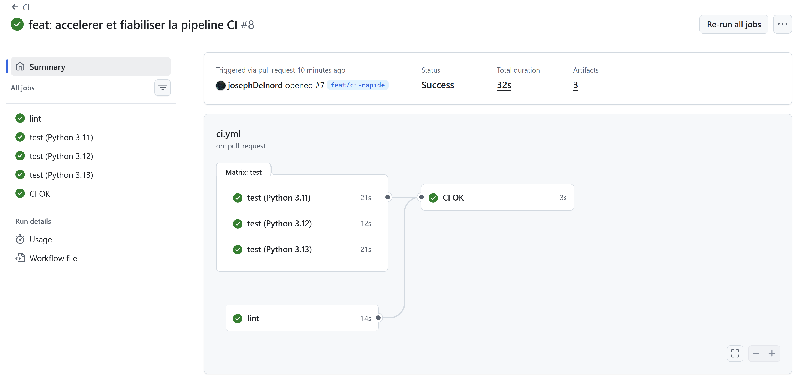

**Étape 2 : PR bloquée malgré des checks verts.** Le ruleset exige encore un check nommé `test`. La matrice a remplacé ce nom par `test (Python 3.11)`, `test (Python 3.12)` et `test (Python 3.13)` : le check attendu n'est jamais rapporté et le merge reste bloqué.

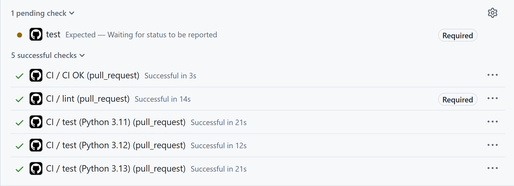

**Étape 3 : `CI OK` comme seul check obligatoire.** Dans le ruleset `protect-main`, les checks `lint` et `test` sont retirés et seul `CI OK` est exigé.

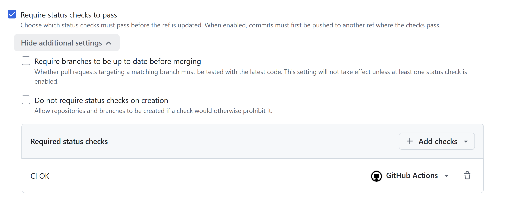

La PR n'attend alors plus que l'approbation du Code Owner.

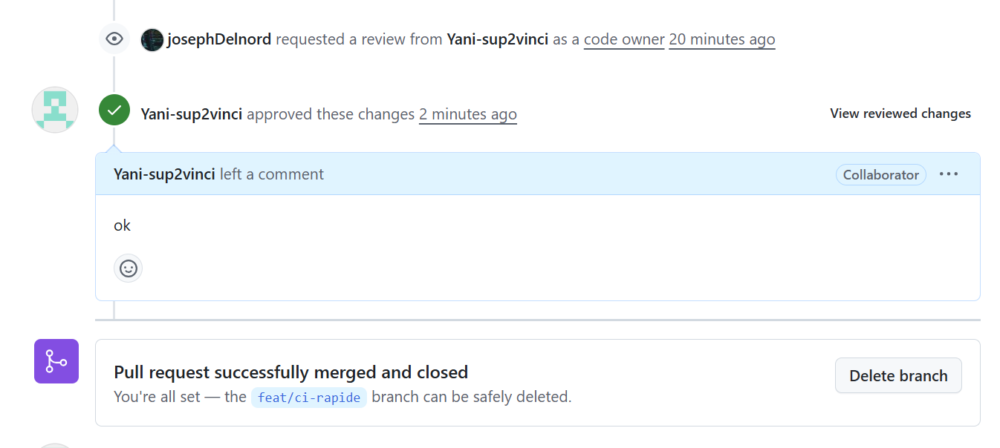

### Mesure du cache pip

Durée de l'étape « Installer les dépendances » relevée dans les détails des jobs, sans cache (run #8, cache miss) puis avec cache (run #10, cache hit) :

| Job | Sans cache (cache miss) | Avec cache (cache hit) |
| --- | --- | --- |
| test (Python 3.11) | 9 s | 5 s |
| test (Python 3.12) | 4 s | 4 s |
| test (Python 3.13) | 6 s | 4 s |
| lint | 5 s | 4 s |
| Durée totale du run | 32 s | 29 s |

Le gain est modeste : les dépendances du projet (pytest, httpx, ruff) sont légères et pip les télécharge rapidement. Le cache devient plus rentable avec des dépendances plus nombreuses ou plus lourdes. Les durées sont celles enregistrées par GitHub, à la seconde près.

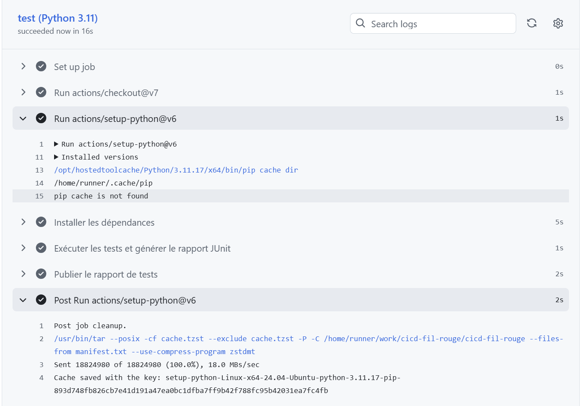

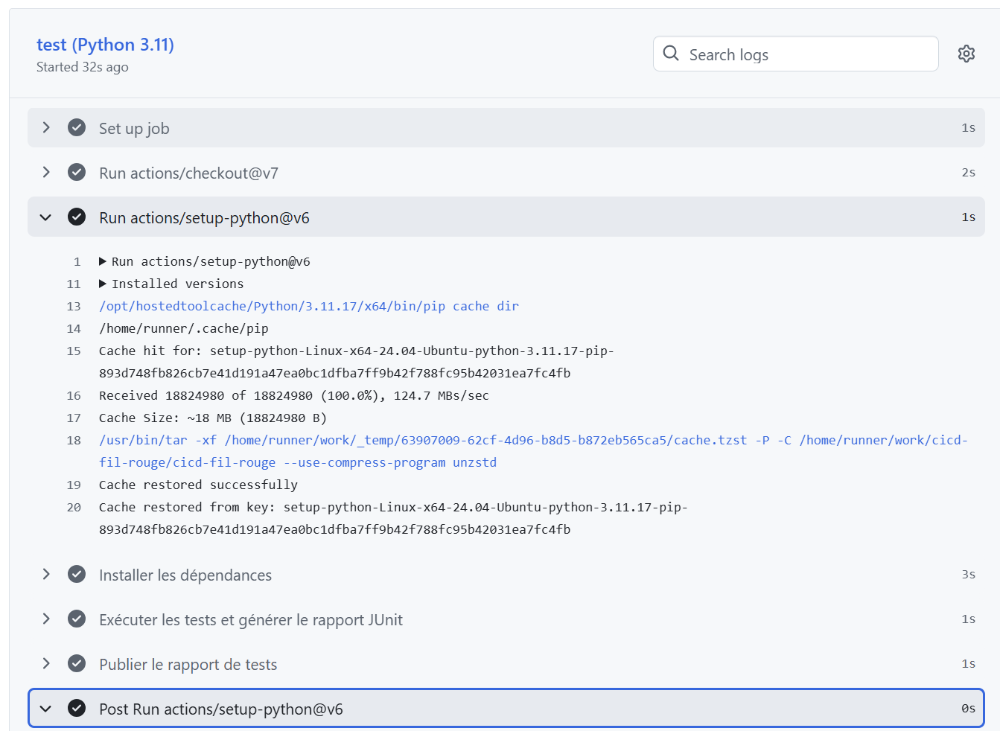

### Rapports de tests

Dans la page du run GitHub Actions, ouvrir **Artifacts** et télécharger `test-results-3.11`, `test-results-3.12` ou `test-results-3.13`. Chaque archive contient le rapport JUnit de la version Python correspondante.

### Captures

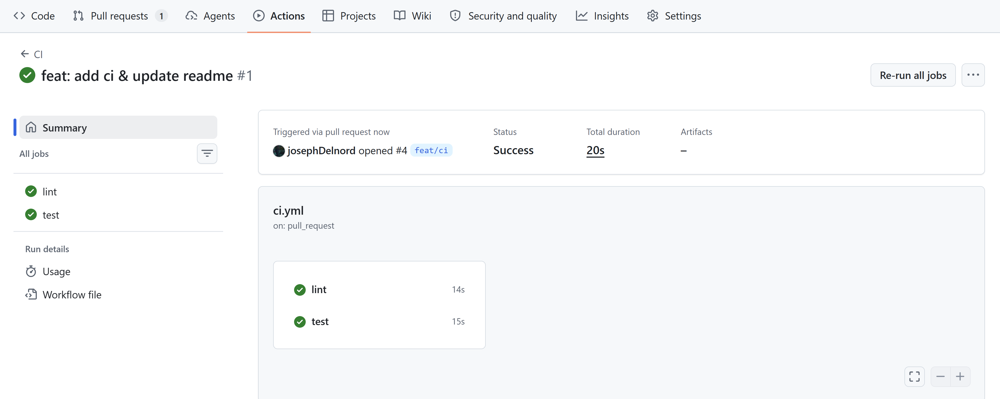

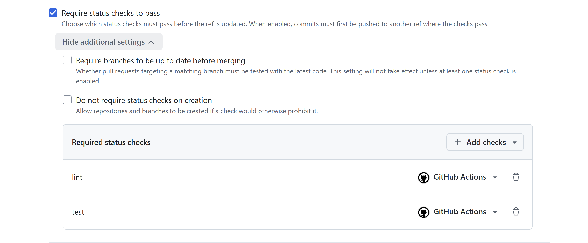

### Démonstration d'une PR bloquée par un test en échec

Sur la branche `fix/casse-test`, le test `test_health_returns_ok` a été volontairement modifié pour attendre une valeur de statut incorrecte.

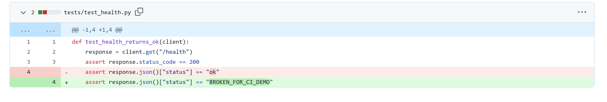

Le job **lint** doit réussir, tandis que le job **test** échoue. Cette démonstration vérifie que le ruleset empêche la fusion lorsque les tests ne passent pas.

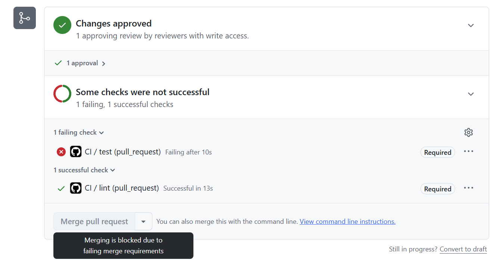
